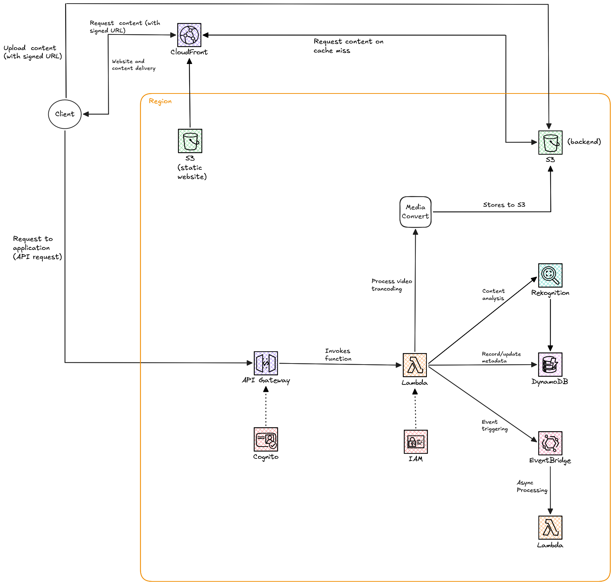

# Designing a Scalable Architecture for a Social Media Application

This document compares traditional and serverless architectures for a social media application. 

The application supports profiles, posts, media uploads, social interactions, and personalized feeds. It requires secure authentication, fast data access, reliable media delivery, and background processing. 

This comparison examines how traditional and serverless architectures meet these needs while balancing scalability, cost, and operational complexity. 

It outlines which workloads each approach suits best and briefly covers these key design choices:

* ECS on Fargate versus EC2
* ECS versus serverless compute (Lambda)
* DynamoDB
* Authentication
* Media processing

## Traditional Architecture

ECS runs the application in containers, making it efficient to deploy and scale tasks independently. 
* The ALB routes requests to ECS services running across multiple Availability Zones. 
* EC2 instances and ECS tasks stay in private subnets, while Auto Scaling Groups add or remove underlying compute capacity as demand changes.
* To create a post, the client sends text and metadata through the ALB to ECS, which validates the request and stores it in DynamoDB. 
* For media, ECS issues a signed upload URL so the client can upload directly to S3 instead of sending large files through the application servers. 
* CloudFront delivers stored content and caches frequently requested media at edge locations.

DynamoDB stores backend data such as profiles, posts, likes, comments, and follow relationships. 
* Its NoSQL key-value design supports fast reads and writes for well-defined access patterns and scales without requiring database server management.
* Keys should be designed around the application's most common queries, such as retrieving a user's posts or feed, because efficient access depends on choosing suitable partition and sort keys.
* When users like or comment on posts, ECS updates the relevant DynamoDB records and can send additional work to SQS, such as feed updates or notifications. 
* S3 stores the uploaded media, while DynamoDB stores the related records and metadata.

When a video is uploaded to S3, an S3 event sends a message to an SQS queue. ECS worker tasks poll the queue and process the video, including transcoding and other content checks, without slowing down the upload or post request. This separates background work from user-facing traffic and lets worker capacity scale with the queue. 

## Serverless Architecture

* The website is hosted in an S3 bucket and delivered through CloudFront. 
* When a user makes a request, it goes to API Gateway, which routes it to the appropriate Lambda function.
* Cognito handles sign-up, login, and identity verification, so authentication is managed separately from the application's processing logic. 
* Lambda functions can be split by task, for example one for profiles, one for posts, and another for interactions, so each function handles a specific part of the application.
* Media is uploaded to S3, and EventBridge can then trigger asynchronous processing. 
* For videos, a Lambda function submits a job to MediaConvert, which creates versions suited to different devices and network conditions.
* The finished formats are saved in separate S3 folders and delivered through CloudFront. 
* Rekognition analyzes media for potential content-policy violations.
* This event-based approach keeps uploads and user requests from waiting on longer processing tasks. 

EventBridge also connects moderation, notifications, and other background tasks. For example, when a post or upload is created, an event can start content analysis, update processing status, or trigger a notification. 
* Lambda functions handle these tasks independently, and failures can be retried or routed for review. 
* This keeps the main application responsive and lets each task scale as needed.

## Comparative Analysis

### ECS on Fargate versus ECS on EC2:
* Using ECS on Fargate instead of ECS on EC2 reduces infrastructure work.
* AWS manages the underlying servers, while ECS runs and scales the containers. 
* Fargate still needs ECS service auto scaling policies to adjust task counts, since it does not decide capacity on its own. 
* With ECS on EC2, Auto Scaling Groups (ASGs) manage host capacity, and ECS places tasks on those hosts. This gives more control over instance types, placement, and runtime resources, but adds the work of managing host capacity and updates. 
* Fargate is simpler to operate and suits variable workloads, while EC2 can be more cost-effective for steady, high-utilization workloads.
* In exchange for managed infrastructure, Fargate gives up some control over the runtime and host.

### DynamoDB database: 
* DynamoDB supports both architectures, so the compute choice does not require changing the database. 
* Likes and comments can be stored as separate interaction records, while a post record holds summary counts. 
* DynamoDB supports atomic counter updates, but popular posts can become write hotspots, so the data model should account for high interaction rates. 

### Authentication: 
* Cognito provides managed sign-up, sign-in, and identity features that work with either architecture. 
* With ECS, the application can implement or integrate authentication itself, which gives more control but adds development and operational responsibility.

### Media transcoding: 
* The serverless design can use S3 events to start MediaConvert jobs, then process completion events for status updates or notifications.
* In an ECS design, a worker service can consume transcoding jobs from a queue and run the processing in containers. This offers more control over tools and processing behavior but requires managing worker capacity.
* MediaConvert can also be used with ECS, since it is a managed transcoding service and not limited to serverless architectures. 

## Conclusion

In summary, Fargate and managed services suit teams that prioritize simpler operations and flexible scaling, while ECS on EC2 may suit predictable, sustained workloads or applications needing more infrastructure control.