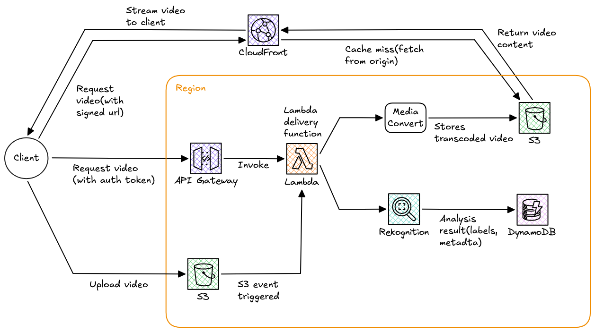

# Video Sharing Platform

This system delivers video using a a serverless architecture with a  client web application, API Gateway, Lambda, DynamoDB, S3, and CloudFront. It separates access and metadata management from video streaming to support efficient, scalable playback.

Uploaded videos are transcoded into multiple resolutions and formats to support different devices and network conditions. Video content analysis can extract information such as duration, thumbnails, and other descriptive metadata, which is stored for playback and discovery. CloudFront serves stored videos from its edge locations, retrieving content from S3 when it is not already cached.

The following section describes the delivery workflows, from video request through playback.

## 1. Video Upload and Storage — client → API Gateway → Lambda → S3

* The client sends an upload request to API Gateway, which invokes a Lambda function to verify the user and prepare the upload.
* Lambda creates a presigned S3 URL and returns it to the client.
* The client uses that temporary URL to upload the video directly to S3.
* S3 is suitable for storing video files because it provides durable, scalable object storage.

## 2. Metadata Handling — client → API Gateway → Lambda → DynamoDB

* The client sends HTTP API requests to API Gateway, which routes them to a Lambda function for processing.
* Lambda can create or update the metadata record in DynamoDB, such as the video ID, owner, S3 location, upload status, duration, and processing results.
* Metadata describes the video and helps the application find or manage it; the video file itself is stored in S3.
* DynamoDB is suitable when the application needs scalable, low-latency access and its data-access patterns fit DynamoDB’s key-value and document model.

## 3. Video Processing — S3 → Lambda → MediaConvert → S3

* When a video is uploaded to S3, an S3 event can trigger a Lambda function.
* Lambda submits a job to AWS Elemental MediaConvert.
* MediaConvert reads the source video from S3, transcodes it into configured outputs—such as different resolutions or streaming formats—and saves those outputs to S3. 
* These versions can help support different playback needs, including adaptive streaming, but they don’t automatically guarantee compatibility with every device.
* Outputs can be organized under separate S3 key prefixes that look like folders; S3 stores the videos as objects by key rather than using traditional folders.
* The videos can be accessed using the key that matches compatibility requirements.

## 4. Content Analysis — S3 → Lambda → Rekognition → DynamoDB

* After upload, Lambda can start an Amazon Rekognition video-analysis job.
* Rekognition offers specific analysis features, such as detecting labels—including objects and activities or identifying content for moderation.
* It doesn’t automatically recognize any object you describe; identifying custom objects may require a custom model.
* Video analysis is generally asynchronous: the system starts the job and handles its results after it completes.
* Lambda can then save selected results or a summary in DynamoDB as metadata associated with the video. 

## 5. Video Delivery — Lambda → CloudFront

* The client first sends an authenticated request through API Gateway.
* Lambda checks the user's access and returns a signed CloudFront URL valid for a limited time.
* The client uses this URL to request the video directly from CloudFront.
* CloudFront validates the URL and checks its edge cache.
* On a cache hit, it serves the video from the edge location; on a miss, it fetches the content from the S3 origin and may cache it for later requests.
* Origin Access Control (OAC) allows CloudFront to access the S3 bucket while keeping the content from being directly accessible to the public.
* Serving video through CloudFront speeds up delivery to the client and reduces traffic to the origin.

## System Design

### Scalability

* The system separates API requests from large video transfers so that each can scale independently.
* API Gateway and Lambda handle lightweight requests, authentication, access checks, and metadata, while clients upload directly to S3 and retrieve videos through CloudFront.
* This approach avoids routing large media transfers through the application backend, allowing video delivery to scale independently from API traffic.
* After upload, an asynchronous transcoding process generates multiple resolutions and streaming formats, so clients do not have to wait for processing to complete and playback is supported across different devices and network conditions.

### Resilience

* For resilience, the system tracks each video's status — such as uploaded, processing, ready, or failed — and ensures that processing jobs are safe to retry. 
* Retaining the original upload allows a failed transcode to be re-run, while clear status updates help the client indicate whether a video is ready. 
* Access controls should be applied to both uploads and playback so that users can only access authorized content.

### Latency

* CloudFront caches video content closer to viewers, reducing delivery latency and the load on S3.
* Adaptive streaming allows the player to select and adjust video quality based on available bandwidth.
* Together, asynchronous processing, retryable jobs, and CDN caching enable the system to handle fluctuations in upload demand while ensuring reliable playback.

